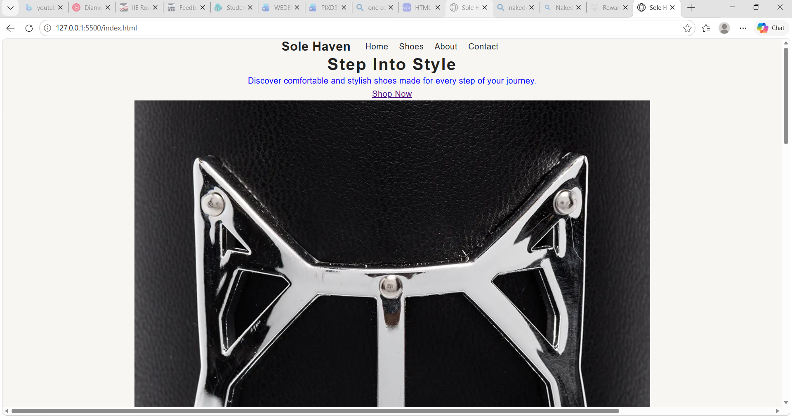
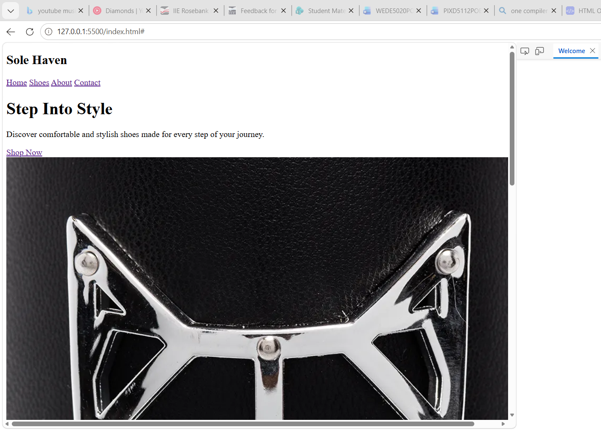
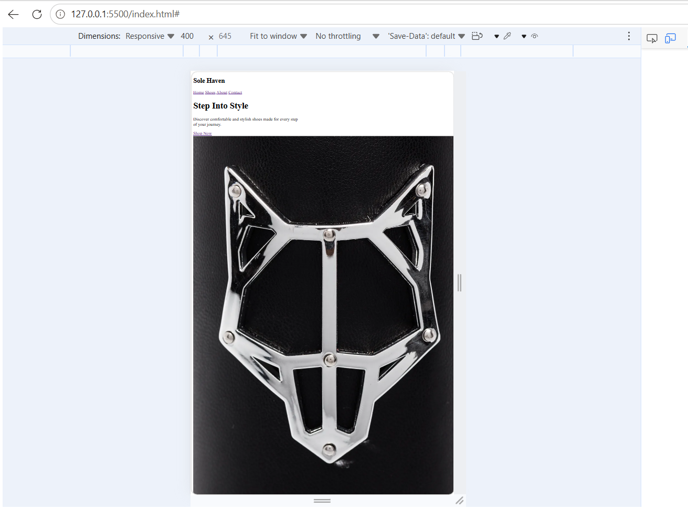

//Simple explanation of part 2//
Responsive Testing

The Sole Haven website was tested at different screen sizes to ensure
that the design works correctly across different devices.

### Desktop
Screen size: 1440 × 900

### Tablet
Screen size: 768 × 1024

### Mobile
Screen size: 375 × 667

### Testing and Iteration

The website was continuously tested at different screen sizes.
Changes were made to the layout, font sizes, navigation and images
to improve the user experience on desktop, tablet and mobile devices.

### change log
Thank you for the helpful feedback on Formative Part 1. I have thoroughly reviewed the issues you mentioned and updated the project files accordingly. Here is a summary of the improvements made:
Fixed Navigation Links: I replaced all placeholder (#) tags in the navigation menus with exact file paths (index.html, about.html, contact.html, etc.). The navigation bar is now consistent across every single page, creating a smooth, fully functional browsing loop.

### CSS resolved 
incorrect directory pathing for the stylesheet (css/styles1.css). This successfully resolved the browser console's MIME type error and ensured my custom styles, grid layouts, and colors load perfectly.

// feedback from part 2 corrected on part 3 //
<link rel="stylesheet" href="CSS/styles1.css">

### change log
### Part 3 – On-Page SEO Improvements

* **Keyword Research:** Identified relevant keywords such as men's shoes, women's footwear, children's shoes, affordable footwear and shoes in South Africa. Incorporated these keywords naturally into website content.

* **Title Tags:** Added descriptive and unique title tags to each HTML page to help search engines identify the content of individual pages.

* **Meta Descriptions:** Added relevant meta descriptions to summarise each webpage and improve its appearance in search engine results.

* **Header Tags:** Improved the heading structure by using appropriate H1, H2 and H3 tags to organise website content and make pages easier to understand.

* **Image Optimisation:** Added descriptive alternative text (alt attributes) to images to improve accessibility and help search engines understand the images.

* **URL Structure:** Used descriptive webpage filenames to make website navigation and page identification easier.

* **Internal Linking:** Added links between relevant website pages to improve navigation and help visitors access different sections of the website.

* **Mobile-Friendliness:** Maintained the responsive design to ensure that the website works across desktop computers, tablets and mobile devices.

### Off-Page SEO Improvements

**Backlinks:**

* Identified opportunities for building quality backlinks through fashion blogs, footwear review websites and local business directories.
* Developed a backlink strategy to improve the online visibility and credibility of Sole Haven Shoes.

**Social Media:**

* Improved the social media section of the website.
* Added links to Facebook, Instagram and TikTok.
* Added a social media section to the homepage footer to make the platforms easier to access.

**Local SEO:**

* Incorporated relevant Johannesburg and South African footwear keywords into website content.
* Improved business location information to support local search visibility.
* Added location-related information to the contact page.

### Enquiry Form Implementation

* Created a new enquiry.html webpage for Sole Haven Shoes.
* Added an HTML enquiry form to allow customers to enquire about footwear products, pricing, sizes and availability.
* Included customer information fields such as full name, email address and phone number.
* Added dropdown menus for enquiry types, shoe categories and shoe sizes.
* Implemented JavaScript form validation to check customer information before processing submissions.
* Added error messages to assist customers when incorrect or incomplete information is entered.
* Implemented a dynamic response section to display a summary of successfully validated enquiries.
* Styled the enquiry form using the shared external CSS stylesheet to maintain consistency across the website.

### Robots.txt and Sitemap.xml Implementation

* Created a robots.txt file in the main website directory to provide instructions to search engine crawlers.
* Configured the robots.txt file to allow search engine crawlers to access the public website pages.
* Added a sitemap reference to the robots.txt file to help search engines locate the website sitemap.
* Created an XML sitemap containing the main Sole Haven Shoes website pages.
* Included the website's absolute URLs in the sitemap to help search engines discover and understand the website structure.
* Prepared both files for accessibility through the deployed website.

## Website Performance and Security Improvements

### Website Performance

* Optimised website images to reduce file sizes and improve loading speed.
* Applied lazy loading to product images to reduce unnecessary image loading.
* Added image dimensions to help prevent unexpected page layout changes.
* Used the `defer` attribute when linking the external JavaScript file.
* Maintained a shared external CSS stylesheet across the website pages.
* Tested website performance using Google PageSpeed Insights.

### Website Security

* Used HTTPS when deploying the website to provide a secure connection.
* Implemented HTML5 and JavaScript form validation to check customer information.
* Limited the information collected through website forms to relevant customer enquiries.
* Organised website files into separate folders for HTML, CSS, JavaScript and images.
* Avoided including confidential information in publicly accessible website files.

### Final Outcome

The Sole Haven Shoes website was improved with additional JavaScript functionality, customer enquiry forms, SEO improvements, performance optimisation and security measures. The website was also deployed online to make it accessible to visitors.

Live Website: [https://capable-cupcake-071ddb.netlify.app/]

## Website Deployment

Hosting Platform: Netlify

Live Website:
https://capable-cupcake-071ddb.netlify.app/

Deployment Status: Successfully Published

